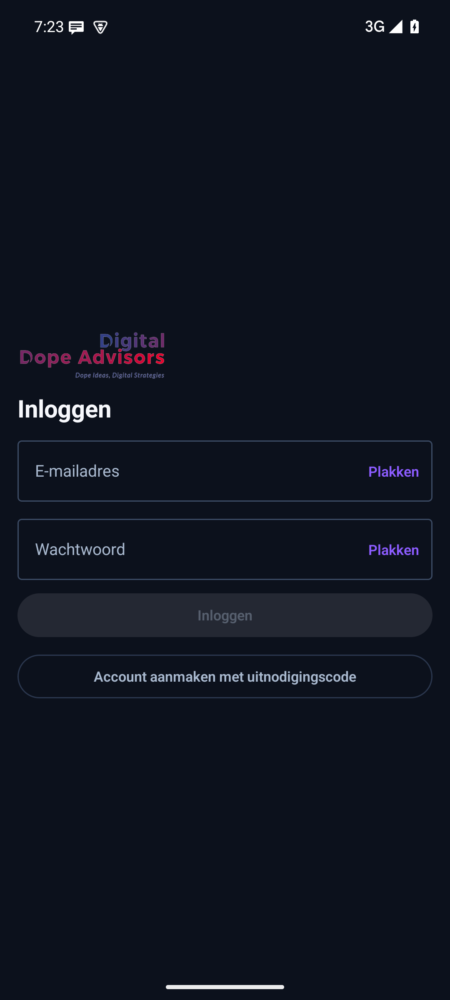
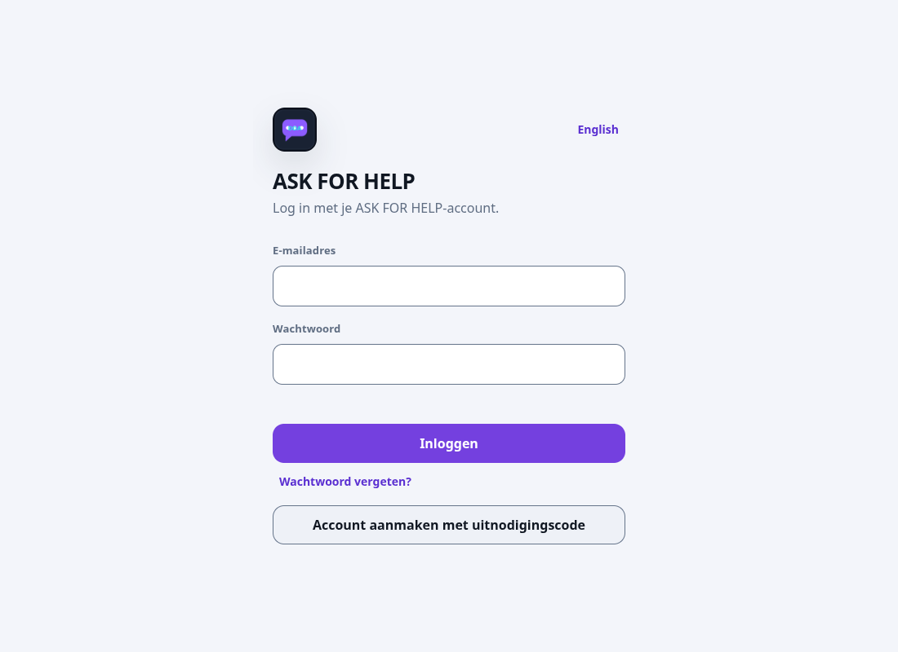
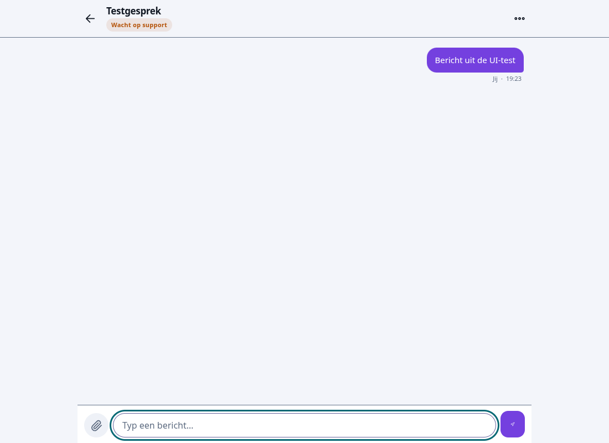
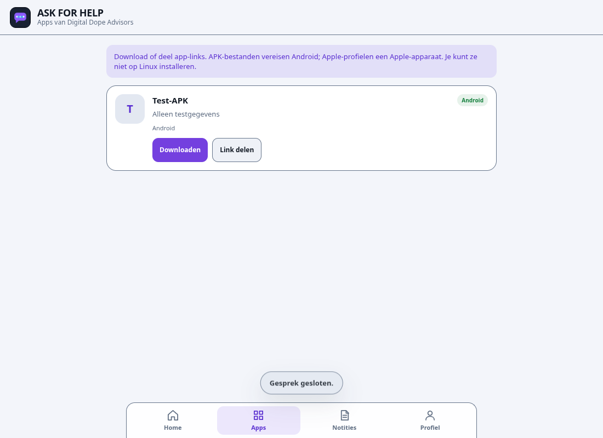
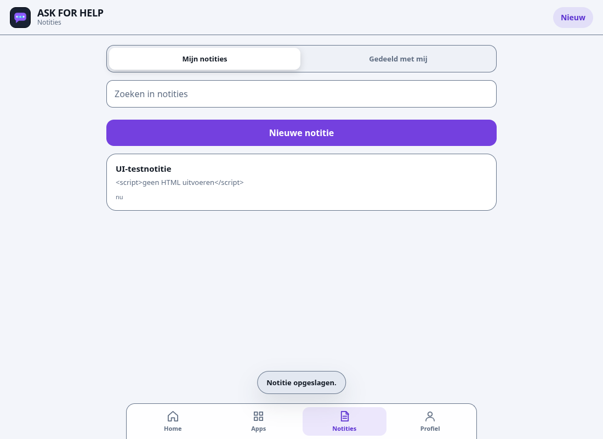
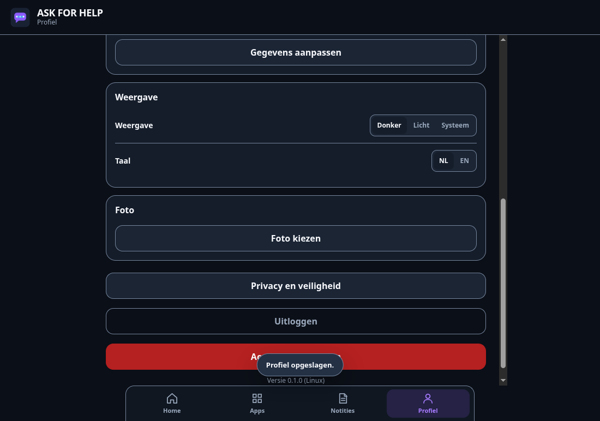

# ASK FOR HELP (DDA)

| Android | Windows | Linux | iPhone / iPad | Samsung TV (Tizen) |
| :---: | :---: | :---: | :---: | :---: |
| [**APK downloaden**](https://github.com/Deus73/ask-for-help-dda/releases/latest/download/ASK-FOR-HELP-Android.apk) | [**Portable EXE downloaden**](https://github.com/Deus73/ask-for-help-dda/releases/latest/download/ASK-FOR-HELP-Windows-Portable.exe) | [**DEB downloaden**](https://github.com/Deus73/ask-for-help-dda/releases/latest/download/ASK-FOR-HELP-Linux-amd64.deb) | [**iOS-broncode**](ios/README.md) | [**Tizen WGT downloaden**](https://github.com/Deus73/ask-for-help-dda/releases/latest/download/ASK-FOR-HELP-Samsung-TV.wgt) |
| {{android}} · Android 8+ | {{windows}} · Windows 10/11 x64 · proefversie | {{linux}} · Debian/Ubuntu amd64 · proefversie | Nog geen IPA/TestFlight | {{tizen}} · Tizen 5.5/6.0 · ongetekend |

De downloadadressen hierboven blijven hetzelfde als een versie verandert.
Android en Tizen worden ieder uur gecontroleerd op nieuwe stabiele releases.
Desktopdownloads worden na een geslaagde desktopbuild bijgewerkt.
[Alle bestanden en SHA-256-controles](https://github.com/Deus73/ask-for-help-dda/releases/latest).

**Let op:** Windows is nog niet op een echte Windows-pc getest en is niet met een
eigen codecertificaat ondertekend. De Samsung TV-WGT vereist een Samsung-certificaat
voordat hij op een retail-tv kan worden geïnstalleerd. Voor iOS is een Mac en
Apple-signering nodig; er wordt hier geen installeerbare IPA beloofd.

## Wat is ASK FOR HELP?

De klant-app van Digital Dope Advisors voor contact met support. Android heet
voorlopig **ASK HELP DDA**; de desktop-app heet **ASK FOR HELP**. De apps gebruiken
dezelfde Firebase-omgeving en hetzelfde klantaccount. De medewerkers-app
**DDA SUPPORT** hoort niet bij deze klantdownloads.

- Chat met support en gesprekken sluiten of verwijderen.
- Eigen notities en notities delen via een deelcode (Android en desktop/iOS-webapp).
- Apps-catalogus met door support gedeelde Android-apps en Apple-profielen.
- Profiel, Nederlands/Engels en licht/donker in de uitgebreide klantapps.
- De Tizen TV-app richt zich op chat en bediening met pijltjes, OK en Terug.

Niet alle Android-functies bestaan op elk OS. Termux, APK-installatie en
Android-schermdeling werken niet op Windows, Linux of iOS. De Tizen-app heeft
niet de volledige catalogus-, notitie- en profielinterface van de andere apps.

## Installatie per OS

### Android
Download de APK, open hem en bevestig de installatie. Android kan eerst
toestemming vragen om apps van deze bron te installeren. Dezelfde APK is voor
telefoon, tablet en Android TV/box. Geen aparte CPU-download nodig.

### Windows portable
Open het ene EXE-bestand. Geen installer of administratorrechten nodig.
Ook te gebruiken vanaf een beschrijfbare USB-stick. De runtime wordt tijdelijk
uitgepakt. `ASK-FOR-HELP-data` naast de EXE bevat cache/appgegevens; aanmeldtokens
blijven alleen in het geheugen. Na sluiten moet je opnieuw inloggen.

### Debian / Ubuntu
Download de `.deb` en installeer vanuit de downloadmap:

```sh
sudo apt install ./ASK-FOR-HELP-Linux-amd64.deb
```

Open daarna **ASK FOR HELP** in het applicatiemenu. Alleen amd64/x86_64,
niet ARM. Het pakket wordt lokaal geïnstalleerd; dit is geen automatische APT-repository.

### Samsung TV en iOS
Zie [Samsung TV](docs/tizen.md) en [iOS](docs/ios.md) voor de bouw- en
signeringsstappen en de beperkingen per platform.

## Gratis backend en bestandsbijlagen

Tekstchat, profielen, notities en de catalogus gebruiken Firestore. De gratis
quota zijn beperkt; onbeperkte opslag of onbeperkt verkeer wordt niet beloofd.
Grote bestanden kunnen als een gedeelde Drive-/HTTPS-link in chat worden verstuurd.
De huidige directe desktop/iOS-upload via Firebase Storage is nog niet beschikbaar:
het project heeft geen Storage-bucket en geen actief billingaccount.
Zie [de Firebase-status](docs/firebase.md) voor de voortgang en gratis alternatieven.

## Screenshots

Echte opnamen van de draaiende apps, geen ontwerpafbeeldingen. Android is
vastgelegd op een emulator. De gedeelde desktopinterface is op Linux vastgelegd
met **uitdrukkelijk herkenbare testgegevens**, niet met echte klantgegevens.
Dit zijn geen screenshots van een fysiek Windows-, iPhone- of Samsung-apparaat.

### Android


### Desktop: inloggen en chat



### Desktop: Apps, notities en donker thema




## Broncode en controles

- [`windows/`](windows/): gedeelde Electron-desktopshell, builds voor Windows portable en Linux DEB.
- [`ios/`](ios/): iOS-shell en de gedeelde klant-webapp.
- [`backend-tests/`](backend-tests/): geïsoleerde Firebase-emulatortests, nooit tegen echte klantdata.
- [`windows/TESTING.md`](windows/TESTING.md): uitgevoerde bedieningstests en nog open controles.
- Android-downloads volgen de bestaande [DDA-releases](https://github.com/Deus73/digital-dope-support-downloads/releases).

## Automatische downloads

[Downloadsync](.github/workflows/sync-downloads.yml) controleert ieder uur de
stabiele Android/Tizen-releases. [Desktop publiceren](.github/workflows/desktop.yml)
bouwt de desktopversie handmatig of na een `desktop-v*`-tag. Beide publiceren naar
de vaste release `downloads`, controleren SHA-256 en werken de versietabel bij.
Als een workflow faalt, blijft de vorige download staan. Het tabblad
[Actions](https://github.com/Deus73/ask-for-help-dda/actions) toont de laatste status.
